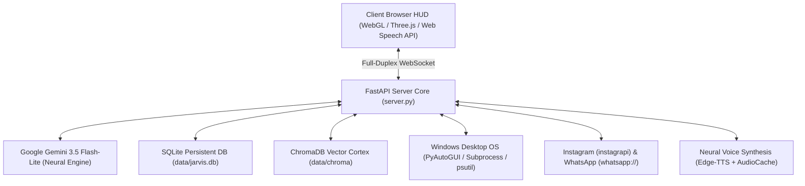

<div align="center">

# ◈ J.A.R.V.I.S. ◈
### *Stark Mark VII Autonomous PC Agent & Neural Holographic Interface*

[](https://python.org)
[](https://fastapi.tiangolo.com)
[](https://deepmind.google/technologies/gemini/)
[](https://threejs.org)
[](https://microsoft.com)

*A sophisticated, hands-on personal AI desktop agent modeled after Tony Stark's iconic J.A.R.V.I.S. featuring full autonomous PC control, hands-free acoustic sentinel wake-word detection, persistent multi-platform memory, and a real-time 3D WebGL Arc Reactor HUD.*

---

</div>

## ⚡ Core Capabilities

### 1. 🎙️ Hands-Free Always-On Acoustic Sentinel
- **Continuous Wake-Word Detection:** Listens client-side for *"Jarvis"* or *"Hey Jarvis"* using continuous Web Speech streams.
- **One-Shot Direct Utterance:** Transcribes and executes direct phrases in real time (*"Jarvis, open Chrome and search for quantum mechanics"*).
- **Two-Stage Standby:** Say *"Jarvis"* alone to hear the Stark prompt chime and activate a 9-second standby listener for your follow-up instruction.
- **Microphone Selection:** Full hardware audio routing with real-time VU audio meter and VAD (Voice Activity Detection).

### 2. ⚛️ 3D WebGL Holographic Arc Reactor
- Rendered in Three.js with multi-tier counter-rotating mechanical rings, gyroscopic gimbal physics, and audio-reactive particle deformation.
- Visualizes neural activity across states: `Standby (Cyan)`, `Listening (Amber)`, `Processing (Cyan Pulse)`, `Recording (Red)`.
- Interactive repulsor shockwave on click and spring-tilt parallax.

### 3. 🖥️ Full Autonomous PC Control & Vision
- **App Management:** Launch and focus applications, browsers, terminals, settings, and file paths.
- **Windows System Authority:** Adjust volume, toggle mute, lock workstation, manage windows, and control media playback.
- **Optical Sensory Viewport:** Real-time visual telemetry, element detection, OCR via RapidOCR, and holographic intel briefings.

### 4. 💬 Social DM Intelligence (Instagram & WhatsApp)
- **Instagram Direct Integration:** Connects via session authentication to read unread DMs, fetch conversation transcripts, and autonomously reply to friends with contextual Gemini intelligence.
- **Instagram Story Publishing:** Programmatically generates and broadcasts branded 9:16 vertical stories.
- **WhatsApp Desktop Integration:** Native Windows protocol link (`whatsapp://`) allowing direct draft preparation and dispatch to phone numbers or contacts.
- **Persistent SQLite Cortex:** All social conversations and chat history persist permanently in `data/jarvis.db` across reboots and browser refreshes.

### 5. 🧠 Vector Memory Cortex
- Built-in ChromaDB vector memory for long-term semantic knowledge retrieval about Sir.
- Live system telemetry: CPU load matrix, RAM utilization, battery charging status, and storage monitoring.

---

## 🛠️ System Architecture



---

## 🚀 Quick Start & Installation

### Prerequisites
- Windows 10/11 (64-bit)
- Python 3.10+
- Modern Chromium browser (Brave, Chrome, or Microsoft Edge)
- Google Gemini API Key ([Google AI Studio](https://aistudio.google.com/))

### 1. Clone the Repository
```bash
git clone https://github.com/<your-username>/jarvis-ai.git
cd jarvis-ai
```

### 2. Set Up Virtual Environment
```bash
python -m venv .venv
.\.venv\Scripts\activate
```

### 3. Install Dependencies
```bash
pip install -r requirements.txt
```

### 4. Configure Environment Secrets
Create a `.env` file from the provided template:
```bash
cp .env.example .env
```
Edit `.env` with your API credentials:
```env
GOOGLE_API_KEY=your_gemini_api_key_here
GEMINI_API_KEY=your_gemini_api_key_here

# Optional: Instagram DM Integration
INSTAGRAM_SESSIONID=your_instagram_session_cookie
```

### 5. Launch J.A.R.V.I.S.
```bash
python server.py
```
Open your browser to:
```
http://127.0.0.1:8765
```

---

## 🗣️ Voice Commands & Protocols

| Voice Command | Protocol Executed |
| :--- | :--- |
| *"Jarvis"* | Awakens Sentinel, sounds chime, and stands by for command |
| *"Jarvis, open Chrome"* | Launches Google Chrome |
| *"Jarvis, what is my CPU load?"* | Reads processor telemetry |
| *"Jarvis, set volume to 50%"* | Adjusts Windows audio master volume |
| *"Jarvis, send WhatsApp message to +1234567890 saying hello"* | Drafts message in WhatsApp Desktop |
| *"Jarvis, check my Instagram messages"* | Fetches unread Instagram friend DMs |
| *"Jarvis, lock the workstation"* | Immediately locks Windows (`LockWorkStation`) |

---

## 🔒 Security & Privacy Boundaries
- Execution rules are enforced in accordance with [`AGENTS.md`](./AGENTS.md).
- Destructive commands (process termination, file deletion, system restarts) strictly require Sir's confirmation card on the HUD.
- Secret credentials (`.env`), databases (`data/jarvis.db`), and session tokens are strictly excluded from version control via `.gitignore`.

---

<div align="center">

*Engineered with precision for Sir.*  
**◈ STARK INDUSTRIES // ALL RIGHTS RESERVED ◈**

</div>
